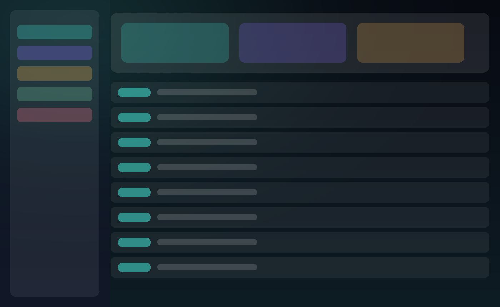

# DevMonitor

The process viewer for people who ship software.

Activity Monitor shows the whole machine. DevMonitor shows the part you are actually working on: the dev server, the port it bound, the git repo it belongs to, and the terminal or editor that launched it.


<p>
  
</p>

These pictures are rendered interface studies of the layout, not captures from a running Mac. The app itself is a native SwiftUI window, dark by default, with live gauges once it is sampling.

## Features

### Process list

A table refreshes about every two seconds.

- PID, name, CPU, resident memory, user, start time, uptime, command line
- Sortable columns, search across name, command, user, PID, port, project, and working directory
- Coloured runtime badges (Node, Python, Go, Docker, Postgres, and the rest)
- A per-process CPU sparkline
- Hide system processes, on by default. Recognised dev runtimes stay visible even as root

### Dashboard

The header sums CPU and memory for developer runtimes, counts listening ports, and draws a short history with Swift Charts. Project chips show each repo’s CPU and memory; click one to filter the list.

### Port radar

A grid of listening sockets. TCP ports open in the browser at `http://localhost:PORT` (wildcard addresses become loopback). Stop sends SIGTERM. A bell watches the port and notifies you when it goes quiet.

### Where it came from

For each process DevMonitor reads the working directory and walks up to the nearest git root. The project name comes from the nearest manifest (`package.json`, `Cargo.toml`, `go.mod`, `pyproject.toml`, `Gemfile`, `Package.swift`, `pom.xml`, `composer.json`, `mix.exs`). The parent chain collapses into a line such as `Cursor → zsh` or `iTerm2 → tmux → zsh`.

From the detail pane you can open that directory in Finder, Terminal, Cursor, or VS Code, copy the command, or copy a restart line and run it in Terminal.

### Detached servers

Node, Python, Ruby, Java, Go, and similar runtimes whose terminal or editor is gone (reparented to `launchd`, with no shell left in the chain) show up under **Detached**. **Clean up** asks before sending SIGTERM. Postgres, Redis, and Docker are not treated as strays.

### Process tree

An outline of the filtered processes, children ordered by CPU.

### Docker

If the `docker` CLI is on `PATH`, a view lists `docker ps`: name, image, status, and published ports. A missing CLI is an empty state, not an error.

### Menu bar

A menu-bar window shows the busiest dev processes and the listening ports, with one-click SIGTERM. The main window still confirms before it signals.

### Watches

Star a process or bell a port. DevMonitor posts a notification when that process disappears or the port is no longer listening.

## Install

Requirements: macOS 14 or later, Xcode 15 or a Swift 5.9+ toolchain. `ps` and `lsof` ship with macOS.

From a checkout of this repository, on a Mac:

```bash
scripts/build-app.sh
open dist/DevMonitor.app
```

`scripts/build-app.sh` runs `swift build -c release`, builds `AppIcon.icns` with `iconutil` when Xcode is present, assembles `dist/DevMonitor.app`, and ad-hoc signs it:

```bash
codesign --force --deep -s -
```

The script prints the absolute path of the bundle. You can also open `Package.swift` in Xcode, select the **DevMonitor** scheme, and run.

Core tests do not need a Mac:

```bash
swift test
```

## Keyboard shortcuts

| Action | Shortcut |
| --- | --- |
| Search | ⌘F |
| Refresh | ⌘R |
| Terminate selected (SIGTERM, confirms) | ⌘⌫ |
| Force quit selected (SIGKILL, confirms) | ⌥⌘⌫ |
| Watch or unwatch the selection | ⌘⇧W |
| Copy the command line | ⌘⇧C |

## Permissions

DevMonitor is not sandboxed. It sees what `ps` and `lsof` show for your user. Other users’ sockets stay hidden unless you run it as an administrator, which this project does not recommend.

Killing a process you do not own fails with a permission message and is not retried. PID 0 and negative PIDs are rejected before `kill(2)`, because the kernel treats them as process groups.

A compiled Go or Rust binary outside `go-build` or `target/{debug,release}` may not get a runtime badge. The command line is still there.

## Architecture

```text
Sources/DevMonitorCore/   parsers, projects, tree, orphans, docker, totals
Sources/DevMonitor/       SwiftUI app, macOS only (#if os(macOS))
Assets/AppIcon.iconset    icon source, turned into an .icns at build time
Tests/DevMonitorCoreTests
scripts/build-app.sh
```

`DevMonitorCore` parses `ps` and `lsof` text, detects git roots and manifests, classifies runtimes, and builds the tree, orphan list, project totals, and Docker rows. It compiles on Linux. The app shells out to `/bin/ps`, `/usr/sbin/lsof`, and `docker`, and draws the result.

Live collection uses:

```text
/bin/ps -axww -o pid=,ppid=,user=,%cpu=,rss=,etime=,command=
/usr/sbin/lsof -nP -iTCP -sTCP:LISTEN
/usr/sbin/lsof -nP -iTCP -sTCP:ESTABLISHED
/usr/sbin/lsof -nP -iUDP
/usr/sbin/lsof -nP -d cwd -Fn
docker ps --format '{{json .}}'
```

RSS from `ps` is kilobytes and is stored as bytes. Start time is “now minus elapsed”, which avoids locale-dependent `lstart`.

## Contributing

Issues and pull requests are welcome.

1. Keep new parsing, classification, and aggregation in `DevMonitorCore`, with unit tests that run under `swift test` on Linux.
2. Guard AppKit and SwiftUI with `#if os(macOS)`. Prefer APIs available on macOS 14.
3. Run `swift test` before you open a pull request. On a Mac, also run `scripts/build-app.sh` and click through the window you changed.

## In breve

DevMonitor è un monitor di processi per macOS pensato per chi sviluppa: porte in ascolto, repository git, catena dei processi padre, server rimasti orfani, container Docker e un extra nella barra dei menu. Si costruisce con `scripts/build-app.sh`. I test del core (`swift test`) girano anche su Linux.

## License

[MIT](LICENSE)
